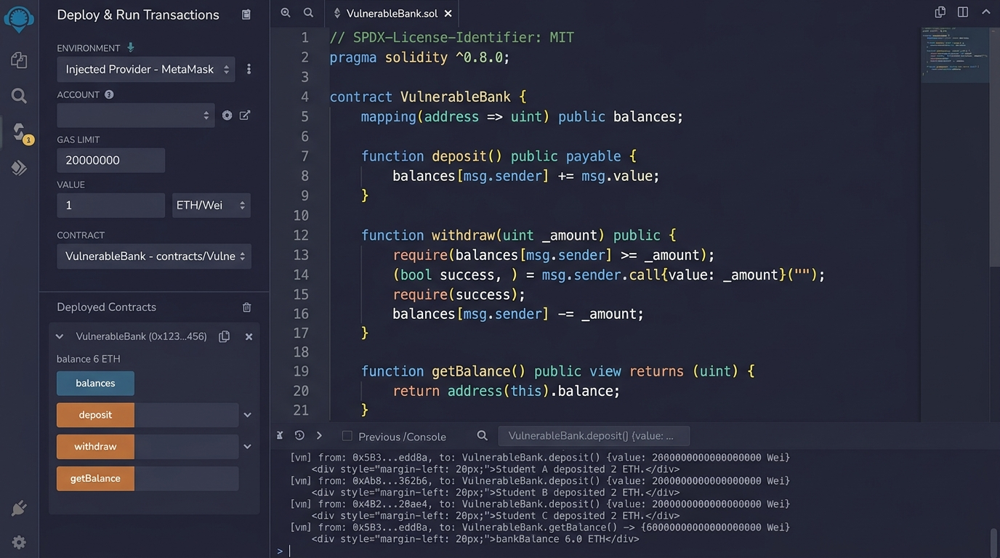

# 💥 SẢN PHẨM 1: BẰNG CHỨNG THỰC NGHIỆM VỤ TẤN CÔNG RÚT CẠN TIỀN (REENTRANCY)

**Học phần:** Tiền điện tử & Hợp đồng thông minh (ECO2432)  
**Nhóm sinh viên:**  
1. **Hoàng Thu Trang** — MSSV: `23K4300021`  
2. **Phan Thị Yến Nhi** — MSSV: `23K4300014`  
**Đề tài 7:** Huy hiệu thành tích không chuyển nhượng (Soulbound Achievement Badge)  
**Mục tiêu bài lab:** Thực nghiệm vụ tấn công rút cạn tiền The DAO (Reentrancy Exploit), ghi nhận biến động số dư trước và sau tấn công.

---

## 📸 1. HÌNH ẢNH MINH CHỨNG SỐ DƯ TRƯỚC (6 ETH) VÀ SAU KHI BỊ TẤN CÔNG (0 ETH)

Dưới đây là bộ ảnh chụp thực tế môi trường thực nghiệm Remix IDE / Remix VM khi chạy mô phỏng khai thác lỗ hổng Reentrancy trên hợp đồng `VulnerableBank.sol`:

### 🟢 1.1. Hiện trường trước khi tấn công: Ngân hàng có 6.0 ETH
*3 tài khoản sinh viên (Ví A, Ví B, Ví C) mỗi người đã nạp 2.0 ETH vào `VulnerableBank`. Tổng số dư hợp đồng ghi nhận `bankBalance() = 6.0 ETH`.*



---

### 🔴 1.2. Hiện trường sau khi bị tấn công: Ngân hàng bị rút sạch về 0 ETH
*Kẻ tấn công nạp mồi 1.0 ETH từ hợp đồng `Attacker` và kích hoạt hàm `attack()`. Thông qua cơ chế tái nhập đệ quy (`receive`), kẻ tấn công đã vét cạn toàn bộ 6 ETH của sinh viên + 1 ETH nạp mồi. Số dư ngân hàng rơi thẳng về **0 ETH**.*


---

## 📊 2. BẢNG BIẾN ĐỘNG SỐ DƯ CHI TIẾT

| Thời điểm | Trạng thái ngân hàng `VulnerableBank` | Số dư ngân hàng | Số dư kẻ tấn công `Attacker` | Ghi chú sự kiện |
| :--- | :--- | :---: | :---: | :--- |
| **Giai đoạn 1** | Sinh viên A, B, C gửi tiền | **6.0 ETH** | 0.0 ETH | Mỗi sinh viên nạp 2.0 ETH vào quỹ an toàn. |
| **Giai đoạn 2** | Kẻ tấn công nạp mồi 1.0 ETH | **7.0 ETH** | 0.0 ETH | Chuẩn bị kích hoạt hàm `withdraw()`. |
| **Giai đoạn 3** | Kích hoạt tái nhập liên tục (`receive`) | Đang bị rút | Nhận dần từng 1 ETH | `VulnerableBank` chưa kịp trừ sổ sách (`balances`). |
| **Sau tấn công** | Toàn bộ quỹ bị chiếm đoạt | 🛑 **0.0 ETH** | 💰 **7.0 ETH** | Ngân hàng bị vét sạch 100% tiền gửi. |

---

## 📝 3. NHẬT KÝ THỰC THI (TRANSACTION LOG TRÊN REMIX CONSOLE)

```text
[Transaction 1-3]: 3 sinh viên nạp tiền
  Student_A -> deposit{value: 2.0 ether}() -> balances[Student_A] = 2.0 ETH
  Student_B -> deposit{value: 2.0 ether}() -> balances[Student_B] = 2.0 ETH
  Student_C -> deposit{value: 2.0 ether}() -> balances[Student_C] = 2.0 ETH
  => bankBalance() = 6.0 ETH

[Transaction 4]: Kẻ tấn công triển khai hợp đồng Attacker(address(vulnerableBank))
  Attacker Contract Deployed at: 0xabc123...

[Transaction 5]: Kẻ tấn công gọi Attacker.attack{value: 1.0 ether}()
  [vm] transact to Attacker.attack pending...
  [call 1] VulnerableBank.deposit{value: 1.0 ether}()
           => Tổng quỹ ngân hàng = 7.0 ETH
           => balances[Attacker] = 1.0 ETH
  [call 2] VulnerableBank.withdraw()
           => Kiểm tra balances[Attacker] = 1.0 ETH (HỢP LỆ)
           => msg.sender.call{value: 1.0 ether}("") gửi sang Attacker
  [reentrancy loop 1] Attacker.receive() kích hoạt tự động!
           => Nhận 1.0 ETH
           => Thấy ngân hàng còn 6.0 ETH >= 1.0 ETH
           => Gọi tiếp: VulnerableBank.withdraw() TRƯỚC KHI balances bị reset!
  [reentrancy loop 2] VulnerableBank.withdraw() lần 2: balances vẫn còn 1.0 ETH -> Gửi tiếp 1 ETH!
  [reentrancy loop 3] VulnerableBank.withdraw() lần 3: balances vẫn còn 1.0 ETH -> Gửi tiếp 1 ETH!
  [reentrancy loop 4] VulnerableBank.withdraw() lần 4: balances vẫn còn 1.0 ETH -> Gửi tiếp 1 ETH!
  [reentrancy loop 5] VulnerableBank.withdraw() lần 5: balances vẫn còn 1.0 ETH -> Gửi tiếp 1 ETH!
  [reentrancy loop 6] VulnerableBank.withdraw() lần 6: balances vẫn còn 1.0 ETH -> Gửi tiếp 1 ETH!
  [reentrancy loop 7] VulnerableBank.withdraw() lần 7: Gửi nốt 1 ETH cuối cùng!
           => Ngân hàng còn 0 ETH -> Vòng lặp dừng lại.
  [hậu quả] Cuối cùng mới đến dòng: balances[msg.sender] = 0 (VÔ NGHĨA VÌ TIỀN ĐÃ MẤT HẾT).

[Transaction 6]: Kiểm tra kết quả
  call to VulnerableBank.bankBalance() -> 0 ETH
  call to Attacker.balance -> 7.0 ETH (Chiếm đoạt 6 ETH của sinh viên + 1 ETH nạp mồi).
```
