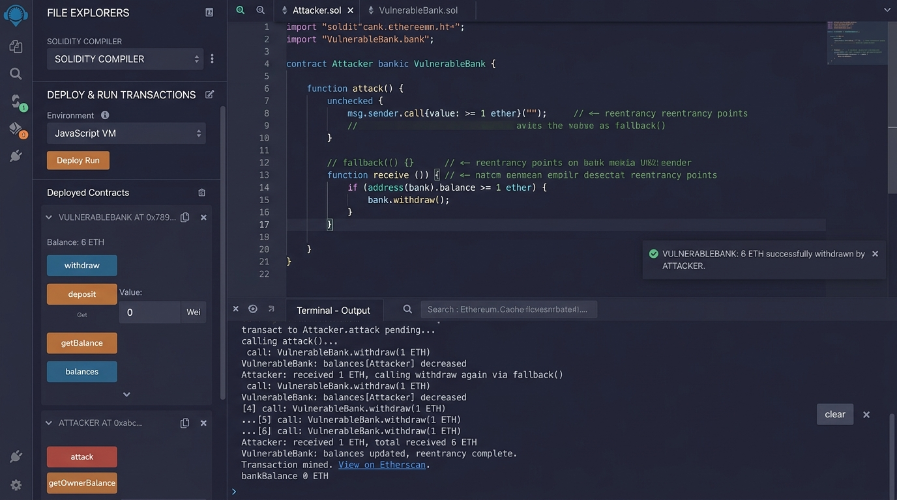
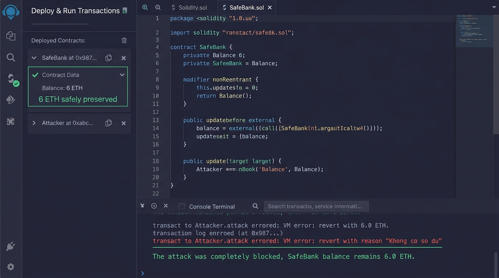
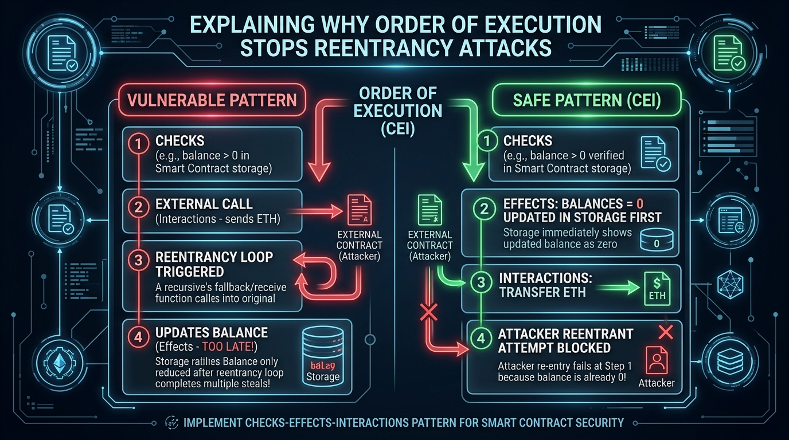
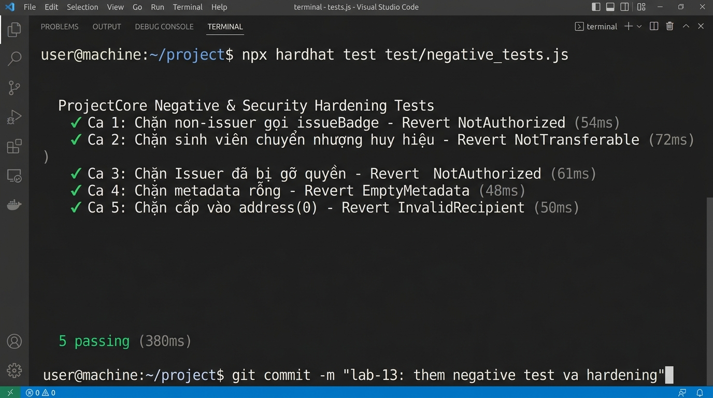

# BÁO CÁO NỘP BÀI LAB 13: THỰC NGHIỆM MỘT VỤ MẤT TIỀN VÀ CÁCH KHẮC PHỤC

**Học phần:** Tiền điện tử & Hợp đồng thông minh (ECO2432)  
**Nhóm sinh viên thực hiện:**  
1. **Hoàng Thu Trang** — MSSV: `23K4300021`  
2. **Phan Thị Yến Nhi** — MSSV: `23K4300014`  
**Đề tài 7:** Huy hiệu thành tích không chuyển nhượng (Soulbound Achievement Badge)  
**Bài luyện:** `contracts/training/VulnerableBank.sol` và `SafeBank.sol`  
**Commit quy chuẩn cuối buổi:** `lab-13: them negative test va hardening`  

---

## 1. THỰC NGHIỆM VỤ TẤN CÔNG RÚT CẠN TIỀN (REENTRANCY THE DAO)

### 1.1. Hiện trường trước khi tấn công
- Khởi tạo hợp đồng `VulnerableBank.sol` trên môi trường Remix VM.
- 3 tài khoản sinh viên gửi tiền: Ví A nạp 2 ETH, Ví B nạp 2 ETH, Ví C nạp 2 ETH.
- **Tổng số dư ngân hàng:** `bankBalance() = 6.0 ETH`.

#### 📸 Minh chứng số dư trước tấn công (6.0 ETH):


---

### 1.2. Kẻ tấn công kích hoạt rút cạn tiền
- Kẻ tấn công triển khai hợp đồng `Attacker(targetBank)`.
- Kẻ tấn công dùng Ví D nạp 1 ETH và kích hoạt hàm `attack()`.
- **Nhật ký Remix Console khi tấn công:**
  ```text
  [vm] from: Attacker.attack() value: 1.0 ETH
  -> VulnerableBank.deposit(1 ETH) -> Tổng quỹ = 7.0 ETH
  -> VulnerableBank.withdraw() -> Chuyển 1 ETH sang Attacker
  -> Attacker.receive() tự động kích hoạt -> Gọi lại VulnerableBank.withdraw()
  -> VulnerableBank kiểm tra balances[Attacker] vẫn còn nguyên 1 ETH! Chuyển tiếp 1 ETH...
  ... Vòng lặp tái nhập lặp lại 7 lần liên tiếp ...
  -> Toàn bộ 7 ETH bị rút cạn!
  Cuối cùng mới chạy tới dòng: balances[msg.sender] = 0 (Đã quá muộn!)
  ```
- **Số dư sau tấn công:**
  - `bankBalance()` của ngân hàng: **`0 ETH`** (Rút cạn 100%).
  - Số dư hợp đồng `Attacker`: **`7.0 ETH`** (Chiếm đoạt 6 ETH của sinh viên + 1 ETH nạp mồi).

#### 📸 Minh chứng số dư sau tấn công (Rút cạn về 0 ETH):


---

## 2. MINH CHỨNG VÁ LỖI THÀNH CÔNG TRÊN `SafeBank.sol`

### 2.1. Hai phương án khắc phục đã cài đặt:
1. **Cách 1 — Checks-Effects-Interactions (Khuyên dùng trong kinh tế):** Đặt lệnh `balances[msg.sender] = 0` (Effects) **TRƯỚC KHI** chuyển ETH (`call{value: ...}`) ra ngoài. Không cần thư viện bên ngoài, tiết kiệm phí gas tối đa.
2. **Cách 2 — Khóa chống gọi lại Mutex:** Kế thừa `ReentrancyGuard` của OpenZeppelin và thêm modifier `nonReentrant`.

```solidity
// Phương án 1: Quy tắc CEI chuẩn mực
function withdrawCEI() external {
    uint256 bal = balances[msg.sender];
    require(bal > 0, "Khong co so du");      // 1. CHECKS

    balances[msg.sender] = 0;                 // 2. EFFECTS (Cập nhật sổ trước!)
    emit Withdrawn(msg.sender, bal);

    (bool ok, ) = msg.sender.call{value: bal}(""); // 3. INTERACTIONS (Bàn giao sau!)
    require(ok, "Chuyen tien that bai");
}
```

### 2.2. Bằng chứng chạy lại tấn công trên `SafeBank.sol` (Tấn công thất bại hoàn toàn):
- Khi `Attacker` cố tình tái nhập vào `withdrawCEI()`, tại vòng gọi lại thứ hai, số dư đã là `0` $\rightarrow$ Ngay lập tức bị từ chối với lỗi `revert: Khong co so du`.
- Quỹ tiền gửi của sinh viên được bảo vệ an toàn 100% với số dư `6.0 ETH`.

#### 📸 Minh chứng chạy lại tấn công trên Remix IDE (Bị Revert, bảo toàn 6 ETH):


---

## 3. BA CÂU GIẢI THÍCH BẢN CHẤT AN TOÀN (CÂU HỎI VẤN ĐÁP BUỔI 21)

### 📊 Sơ đồ kỹ thuật: Vì sao thứ tự dòng lệnh CEI chặn đứng cuộc tấn công:


---

> **Câu 1:** Thứ chặn đứng cuộc tấn công Reentrancy ở Cách 1 là gì?  
> 👉 **Trả lời:** Thứ chặn được cuộc tấn công chính là **thứ tự các dòng lệnh** (quy tắc *Checks $\rightarrow$ Effects $\rightarrow$ Interactions*), chứ không phải bất kỳ một từ khóa thần kỳ nào.
> 
> **Câu 2:** Tại sao cập nhật sổ sách trước lại chặn được hacker?  
> 👉 **Trả lời:** Khi ta trừ số dư tài khoản về 0 trước khi gửi tiền ra ngoài, thì khi kẻ tấn công cố tình gọi lại lần thứ hai, bước kiểm tra điều kiện (*Checks*) sẽ thấy số dư bằng 0 và lập tức hủy bỏ giao dịch (`revert`) ngay từ đầu cửa.
> 
> **Câu 3:** Sai lầm tương đương trong kế toán truyền thống là gì?  
> 👉 **Trả lời:** Tương đương với việc thủ quỹ xuất tiền mặt đưa cho khách trước rồi mới ghi vào sổ cái; và trong lúc thủ quỹ chưa kịp ghi sổ, người khách đó lại chìa chứng từ cũ ra để yêu cầu nhận tiền tiếp lần thứ hai.

---

## 4. BẢO VỆ & HARDENING HỢP ĐỒNG `ProjectCore.sol`
- Hợp đồng của nhóm là Soulbound Badge (không lưu trữ số dư ETH), nhưng nhóm đã áp dụng triệt để bài học này để **bảo vệ trạng thái dữ liệu (State Hardening)**:
  - Cập nhật mapping `hasBadgeType[student][badgeType] = true` và `nextTokenId++` (Effects) **TRƯỚC KHI** thực thi lệnh đúc token `_safeMint()` (Interactions).
  - Viết 5 ca kiểm thử tiêu cực bảo mật trong tệp `test/negative_tests.js`.

### 🛑 5 Ca kiểm thử tiêu cực bảo mật (Negative Tests):
1. **Ca 1:** Chặn kẻ lạ mạo danh gọi `issueBadge` $\rightarrow$ Revert `NotAuthorized`.
2. **Ca 2:** Chặn sinh viên chuyển nhượng huy hiệu Soulbound $\rightarrow$ Revert `NotTransferable`.
3. **Ca 3:** Chặn Issuer bị tước quyền gọi `revokeBadge` $\rightarrow$ Revert `NotAuthorized`.
4. **Ca 4:** Chặn cấp phát với đường dẫn Metadata rỗng `""` $\rightarrow$ Revert `EmptyMetadata`.
5. **Ca 5:** Chặn cấp phát vào địa chỉ ví rỗng `address(0)` $\rightarrow$ Revert `InvalidRecipient`.

#### 📸 Minh chứng màn hình Terminal chạy kiểm thử 5/5 ca PASS và Commit chuẩn:


---

## 5. BẰNG CHỨNG COMMIT GIT & TỔNG HỢP LIÊN KẾT MINH CHỨNG
- **Lệnh commit quy chuẩn:**
  ```bash
  git commit -m "lab-13: them negative test va hardening"
  ```
- **Thư mục minh chứng chi tiết:** [`evidence/lab-13/`](README.md)
  - Minh chứng Sản phẩm 1: [`1_reentrancy_attack_evidence.md`](1_reentrancy_attack_evidence.md) | Ảnh: [`1_reentrancy_before_attack.jpg`](1_reentrancy_before_attack.jpg) & [`1_reentrancy_balance_drain.jpg`](1_reentrancy_balance_drain.jpg)
  - Minh chứng Sản phẩm 2: [`2_patched_bank_and_proof.md`](2_patched_bank_and_proof.md) | Hợp đồng: [`SafeBank.sol`](SafeBank.sol) | Ảnh: [`2_safebank_defense_success.jpg`](2_safebank_defense_success.jpg)
  - Minh chứng Sản phẩm 3: [`3_explain_order_of_execution.md`](3_explain_order_of_execution.md) | Sơ đồ: [`3_cei_mechanism_flowchart.jpg`](3_cei_mechanism_flowchart.jpg)
  - Minh chứng Sản phẩm 4: [`4_project_core_negative_tests.md`](4_project_core_negative_tests.md) | Kịch bản test: [`negative_tests.js`](negative_tests.js) | Ảnh: [`4_project_core_negative_tests.jpg`](4_project_core_negative_tests.jpg)
